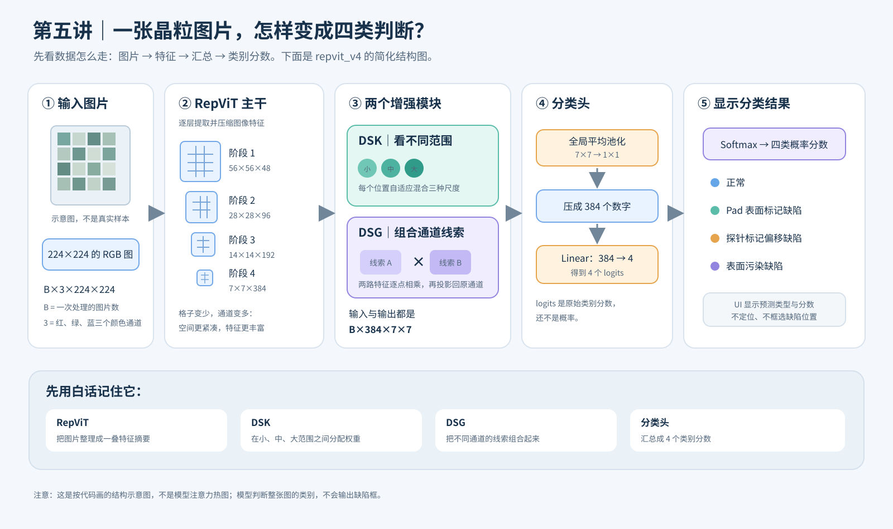
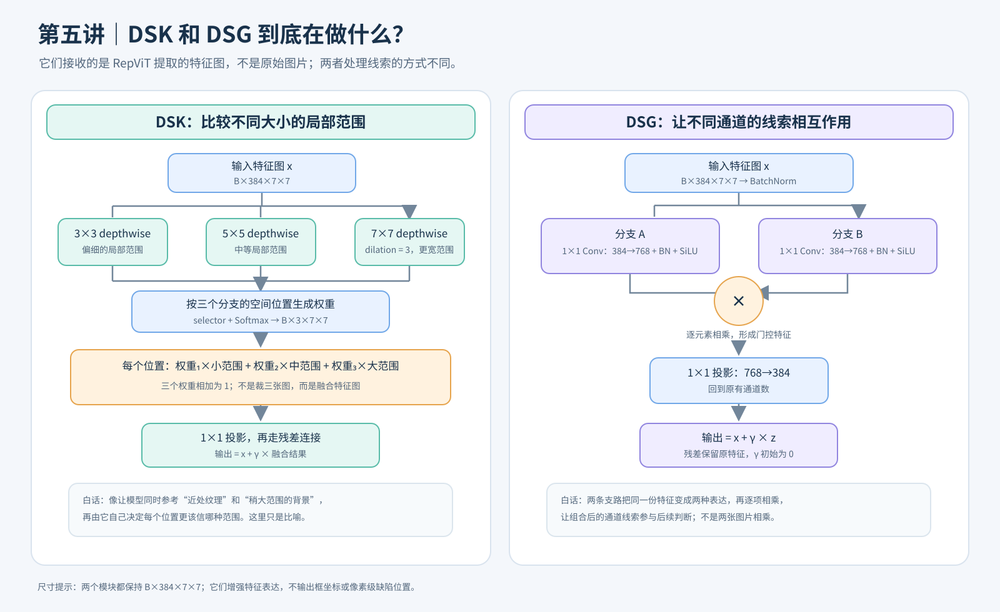
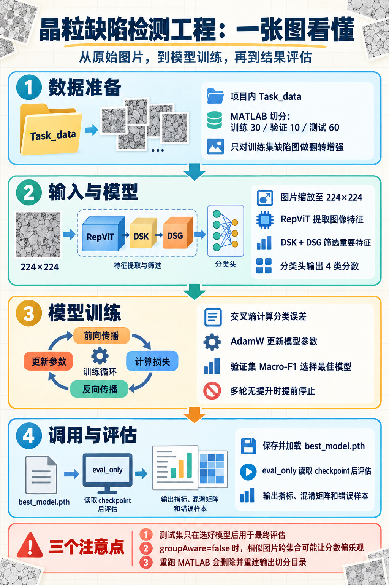

# 晶粒缺陷检测工程学习笔记

更新时间：2026-10-22（补充离线阅读入口，保留原有分讲内容）  
工程目录：`E:\Codex\科研\wafer_defection_detect\ZIP\晶粒缺陷检测代码\晶粒缺陷检测代码`  
项目启动分析与会议目标：[晶粒缺陷检测项目启动分析与工作记录](../../../../晶粒缺陷检测_启动分析与工作记录.md)

离线修改入口：[离线改代码指南](离线改代码指南.md)。源码已补中文注释，旧讲义引用的行号可能变化，请用函数名定位；正文中的旧 `detect` 路径应对应到当前 `wafer_defection_detect`。

## 学习方式与进度

按小节逐步阅读：先画清数据和程序的流向，再读数据处理、模型、训练、评估和结果。每节记录代码位置、中文解释、一个安全观察练习和自测题。不运行会覆盖数据的 MATLAB 脚本，不默认启动耗时训练。

- 已完成：第 1–5 讲，覆盖工程地图、数据切分、图像读取、训练命令、RepViT/DSK/DSG/分类头；第五讲已补充两张结构示意图和白话解释。
- 下一讲：读训练循环（按小批次反复更新模型参数），理解损失（衡量预测错多少）、优化器（更新参数的方法）、验证集（不参与参数更新、只用来检查效果的数据）、Macro-F1（综合各类的判对与漏判情况后等权平均）和早停（验证效果多轮不改善时提前停止）。
- 第五讲的代码理解阶段用未预训练 RepViT 和全零假输入观察特征尺寸；本次图解补充只改学习文档并新增 SVG，没有读取工程图片或启动训练/评估。

## 1. 先把工程看成一条流水线

```text
Task_data 原始类别目录
  → MATLAB main.m
  → split_dataset_by_ratio_with_aug.m
  → Task_data_30_10_60_aug/{train_raw, train, val, test}
  → Python ImageFolder 读取 train/val/test
  → 图像变换 → 分类模型 → 验证与测试结果
```

这是**整张图像的四分类**：模型给一张图一个类别，不输出缺陷框或像素轮廓。四个目录类别是 `normal`、`pad_surface_mark_defect`、`probe_mark_offset_defect`、`surface_contamination_defect`。

## 2. 文件夹地图

| 路径/文件 | 作用 | 学习时注意 |
|---|---|---|
| `Task_data/` | 工程内的原始图片，按四个类别分文件夹 | 当前共 48,480 张；以目录名作为类别标签 |
| `main.m` | 当前 MATLAB 数据处理入口 | 只调用“按比例切分并增强”函数 |
| `split_dataset_by_ratio_with_aug.m` | 切分、复制、训练集离线增强、写统计 CSV | 输出目录已存在时会删除并重建 |
| `split_dataset_by_ratio.m`、`split_dataset_kfold.m` | 其他切分方案 | 当前 `main.m` 没有调用它们 |
| `rename_grain_dataset_files.m` | 把分割内文件改成数字前缀名称 | 写死了另一台机器的目录，且 `dryRun=false`；会真实改名，先不要运行 |
| `Task_data_30_10_60_aug/` | 已有的切分结果和统计摘要 | Python 训练脚本读取其中的 `train/val/test` |
| `code/benchmark_grain_4class_repvit_project_v3_eval_misclass_fixed.py` | 模型定义、训练、评估、指标和错误样本导出 | 主 Python 文件较长，按函数入口分段读，不必逐行通读 |
| `code/代码运行样例.txt` | 旧机器上的训练与评估命令 | 环境和绝对路径已过时；参数思路可读，路径不要照搬 |
| `code/results_grain4v3/` | 已有训练产物，含 checkpoint 和训练指标 | 这是历史结果，不代表本次重新运行 |
| `code/eval_results_grain4v3/` | 已有 eval-only 评估导出 | 与训练产物目录分开 |

## 3. 第 1 讲：读懂 `main.m`

入口内容可压缩成下面这段：

```matlab
split_dataset_by_ratio_with_aug( ...
    './Task_data', ...
    './Task_data_30_10_60_aug', ...
    [30 10 60], ...
    {'train','val','test'}, ...
    false, ...
    2026);
```

逐项看：

1. `./Task_data`：输入原始数据目录。
2. `./Task_data_30_10_60_aug`：输出目录。
3. `[30 10 60]` 与 `{'train','val','test'}`：按 30%/10%/60% 分为训练、验证、测试。
4. `false`：`groupAware=false`，每张图片独立随机切分；同一来源的相似裁片可能跨集合。
5. `2026`：随机种子，让随机划分可重复。

**相对路径要看 MATLAB 当前工作目录。** 先把 MATLAB 的 Current Folder 设为工程根目录，`./Task_data` 才会指向这里的 `Task_data`。仅仅打开这个位置下的 `main.m`，不保证当前工作目录也自动正确。

**覆盖风险：** `split_dataset_by_ratio_with_aug.m` 会在输出目录已经存在时删除整个目录，再重新生成。因此当前已有的 `Task_data_30_10_60_aug` 不可直接拿来做试运行目标；本学习过程先只读代码，不执行 `main.m`。

### 这一入口实际产出的数据

- `train_raw/`：未经增强的训练图片副本。
- `train/`：原训练图片加离线增强图片，Python 实际读取它。
- `val/`、`test/`：保留原图，不做离线增强。
- 三类缺陷的训练图片各生成水平翻转、垂直翻转版本；`normal` 不增强。
- 现成原始划分：train/val/test 共 14,545/4,848/29,087 张；增强后 `train/` 共 25,095 张。

统计依据：`Task_data_30_10_60_aug/split_summary_raw.csv`、`split_summary_augmented.csv`、`augmentation_summary.csv`。

### 安全观察练习

在 PowerShell 中只查看路径和类别目录，不启动 MATLAB：

```powershell
Set-Location 'E:\Codex\科研\detect\ZIP\晶粒缺陷检测代码\晶粒缺陷检测代码'
Get-Location
Test-Path .\Task_data
Get-ChildItem .\Task_data -Directory | Select-Object -ExpandProperty Name
```

预期：当前目录是工程根目录；`Test-Path` 返回 `True`；随后列出四个类别目录。此练习不会改动数据。

### 自测

1. `main.m` 的第五个参数 `false` 控制什么？这对评估可信度有什么潜在影响？
2. 为什么在看懂脚本前不直接运行 `main.m`？
3. `train_raw` 和 `train` 有什么区别？Python 训练代码读取哪个目录？

**已答第 1 题：** `groupAware=false` 表示逐图随机切分；若同源或近重复图片跨集合，模型可能见过测试图的相似纹理，导致分数偏高。但它不证明当前数据一定泄漏，关键要看来源是否独立。

## 4. 第 2 讲：切分函数如何处理每张图片

主函数是 [`split_dataset_by_ratio_with_aug.m`](split_dataset_by_ratio_with_aug.m)。按执行顺序读：

1. **准备参数。** `main.m` 传入数据路径、输出路径、比例、集合名、`groupAware=false` 和种子 `2026`。函数把比例归一化，因此 `[30 10 60]` 变成 `[0.3 0.1 0.6]`；增强类别和增强方式没有传入时，默认是“除 `normal` 外的类别”和 `hflip/vflip`。
2. **检查并创建目录。** 输入目录不存在会报错；但输出目录如果已经存在，会执行递归删除再创建。这也是不能直接重跑 `main.m` 的原因。函数也没有检查输入目录和输出目录是否设成同一路径，使用时必须保证两者不同。
3. **逐类别处理。** 函数一次处理一个类别，收集目录下常见图片格式，然后在该类别内部独立打乱、按比例分配。因此这是按类别分别切分，不是先混合所有类别再切。
4. **决定切分单位。** 当前 `false` 分支把每个文件作为一个单位，用 `randperm` 打乱后切分。若设为 `true`，代码会从文件名去掉末尾的 `_数字` 作为组名，再按组打乱；同组文件会一起进入一个集合。边界用累计比例乘单位数并四舍五入来确定。
5. **复制原图。** 训练原图复制一份到 `train_raw/`，再复制一份到 `train/`；验证和测试原图各自复制到对应目录。
6. **只增强训练集。** 函数从 `train_raw/` 读取训练原图，默认生成水平翻转和垂直翻转图并写入 `train/`。验证、测试图不增强。图片读取或写入失败会给出 warning，并跳过相应增强。
7. **保存统计。** `split_summary_raw.csv` 记录未增强划分；`split_summary_augmented.csv` 记录训练增强后的数量；`augmentation_summary.csv` 记录每类生成的增强数量。

### 这一工程中 `groupAware=true` 也未必能按真实来源分组

分组规则只是文件名启发式：去掉最后的 `_数字`。例如 `000001_1_05.jpg` 会得到组名 `000001_1`。我对当前 `Task_data` 文件名按“去掉末尾 `_数字`”这一步做了只读统计，四类都是“文件数 = 推断键数”，没有重复键。也就是说，按目前文件名，脚本看不出多张图片属于同一组；**仅把参数改成 `true`，不能据此保证同源图不跨集合**。如果老师确认存在同一晶粒/同一母图裁片，应先取得来源标识或可靠分组表。

### 现成切分数量对照

| 类别 | train 原图 | val | test | 增强后 train |
|---|---:|---:|---:|---:|
| normal | 9,270 | 3,090 | 18,540 | 9,270 |
| pad_surface_mark_defect | 2,340 | 780 | 4,679 | 7,020 |
| probe_mark_offset_defect | 1,800 | 600 | 3,599 | 5,400 |
| surface_contamination_defect | 1,135 | 378 | 2,269 | 3,405 |
| 合计 | 14,545 | 4,848 | 29,087 | 25,095 |

这些值来自工程已有 CSV，没有重新生成数据。翻转是否符合晶粒/探针缺陷的实际方向语义，还要结合老师确认的标注与任务要求判断；这里记录的是代码当前做法，不代表它已被验证为最佳增强策略。

### 自测

1. `groupAware=true` 如何从文件名构造组？为什么当前数据即使打开这个选项，仍不能保证同源图片不跨集合？
2. 原始训练图为什么同时放进 `train_raw/` 和 `train/`？
3. 为什么增强只在切分之后对训练图执行？

本讲只读代码和现有统计文件，没有运行 MATLAB，也没有更改数据。
本讲只读检查了现有代码和 CSV，没有运行 MATLAB、重建数据或更改工程代码。

## 5. 第 3 讲：图片如何成为 Python 模型输入
这里说的 Python 代码是：
[benchmark_grain_4class_repvit_project_v3_eval_misclass_fixed.py](E:/Codex/科研/detect/ZIP/晶粒缺陷检测代码/晶粒缺陷检测代码/code/benchmark_grain_4class_repvit_project_v3_eval_misclass_fixed.py)
它通过必填参数 --data_root 接收数据集根目录，再加载该目录下的 train/、val/、test/。训练集读取路径是 data_root/train，由 datasets.ImageFolder 加载；代码没有读取 train_raw/。[数据加载位置 (line 172)](/E:/Codex/科研/detect/ZIP/晶粒缺陷检测代码/晶粒缺陷检测代码/code/benchmark_grain_4class_repvit_project_v3_eval_misclass_fixed.py:172)
因此，这段笔记里的“Python 从 Task_data_30_10_60_aug 读取”指的是：运行这份脚本时，把 Task_data_30_10_60_aug 作为 --data_root 参数传入。脚本本身通过参数指定路径，并非把这个目录写死在代码里。

数据切分完成后，Python 从 `Task_data_30_10_60_aug` 读取 `train/`、`val/`、`test/`。它不读取 `train_raw/`；`train_raw/`是未经增强的训练原图留档，`train/`才是“原图 + 离线翻转图”的训练目录。

### 从目录名得到标签

脚本用 `torchvision.datasets.ImageFolder` 分别读取三个目录。类别子文件夹名就是标签名；现成训练记录中的 `data_info.json` 显示映射为：

| 文件夹名 | 标签编号 |
|---|---:|
| `normal` | 0 |
| `pad_surface_mark_defect` | 1 |
| `probe_mark_offset_defect` | 2 |
| `surface_contamination_defect` | 3 |

训练、验证、测试三份数据的类别映射必须相同；代码若发现不一致就直接报错，避免同一个编号在不同集合里代表不同类别。这个映射和数量取自已有运行记录，不是本次重新训练的输出。

### 每张图经过的变换

`build_transforms()` 对训练、验证和测试都使用同一套处理：

```text
Resize(224×224) → ToTensor → Normalize(ImageNet 均值和标准差)
```

- `Resize`：把模型输入统一成 224×224。若原图不是正方形，这种写法会直接拉伸长宽比；是否影响缺陷形状判断，后续需要查看原图尺寸并结合任务决定。
- `ToTensor`：把图片转成 PyTorch 张量，供模型计算。
- `Normalize`：按 ImageNet 的通道均值和标准差标准化；和预训练模型的常用输入约定保持一致。

注意：代码里**没有在线随机增强**，`train_transform` 与 `eval_transform` 实际是同一个变换对象。训练集的水平、垂直翻转图是在 MATLAB 阶段提前保存到磁盘的。

### DataLoader 做什么

`build_dataloaders()` 把图片逐批装入迭代器：训练集 `shuffle=True`，每轮打乱样本顺序；验证集和测试集 `shuffle=False`，按稳定顺序读取。三个目录都使用 `batch_size` 和 `num_workers` 参数；已有运行记录里的数量是 train/val/test = **25,095/4,848/29,087**。

可以把一批数据想成：若 batch size 是 64，图片张量大致是 `[64, 3, 224, 224]`，标签是 64 个类别编号；四分类模型对每张图输出四个类别分数。下一讲会沿着这些分数进入模型结构。

### 安全观察练习

只查看旧运行保存的类别映射和数据数量，不启动模型：

```powershell
Get-Content '.\code\results_grain4v3\grain4v3\repvit_v4\seed_2026\data_info.json'
```

前提是 PowerShell 当前目录位于工程根目录。预期能看到 `num_classes: 4`、上述 `class_to_idx` 映射，以及 train/val/test 的数量。此文件是历史运行记录。

### 自测

1. Python 训练脚本读取 `train_raw/` 还是 `train/`？为什么？
2. MATLAB 已经做了翻转增强，Python 的 `train_transform` 还会再随机翻转吗？
3. 如果数据里存在非正方形原图，`Resize((224,224))` 可能改变什么？

本讲只读查看了变换与加载代码、CSV 和历史 `data_info.json`，没有运行训练或改动数据。

## 6. 第 4 讲：读懂代码运行样例——训练与独立评估

讲解对象是 [`代码运行样例.txt`](code/代码运行样例.txt)，对应脚本是 [`benchmark_grain_4class_repvit_project_v3_eval_misclass_fixed.py`](code/benchmark_grain_4class_repvit_project_v3_eval_misclass_fixed.py)。附件内容来自旧电脑：Conda 环境路径和 `cd` 到的工程路径都不属于当前工程，不能直接照搬。它展示的是先训练、再单独评估已有 checkpoint 的两步流程。

### 样例两条 Python 命令分别做什么

1. **训练命令**：载入切分数据，训练 `repvit_v4`，最多训练 30 个 epoch，并把模型、日志和指标写入 `output_root/task_name/model/seed_x/`。
2. **评估命令**：带 `--eval_only`，不训练；从 `checkpoint_root` 找 `best_model.pth`，在命令指定的集合上重新计算并导出结果。

样例里的 `conda activate ...` 是激活 Python 环境；两行 `cd` 是旧机器的目录切换写法。当前应先进入本机的 `code` 目录，再运行脚本。`--data_root` 等相对路径相对于**当前 PowerShell 工作目录**解析，不是相对于脚本文件所在位置自动解析。

### 训练命令中的参数

| 参数 | 样例值 | 含义 |
|---|---|---|
| `--data_root` | `../Task_data_30_10_60_aug` | 必填；目录下应有 `train/`、`val/`、`test/`。从 `code` 目录运行时，这会指向工程根目录的数据切分。 |
| `--task_name` | `grain4v3` | 必填；实验标签，会成为输出路径的一层目录名。 |
| `--output_root` | `./results_grain4v3` | 训练结果总目录。实际单次运行路径会继续拼接任务名、模型名和随机种子。 |
| `--models` | `repvit_v4` | 指定要运行的模型；支持逗号分隔。这里仅选一个模型。省略时会运行脚本配置的默认模型列表。 |
| `--seeds` | `2026` | 随机种子列表；这里仅运行一次。省略时默认使用 `2026,2027,2028`。 |
| `--epochs` | `30` | 最大训练轮数，不保证一定跑满；早停可能提前结束。 |
| `--batch_size` | `64` | 每个训练批次的图片数；显存不足时通常需要调小。 |
| `--num_workers` | `8` | DataLoader 并行加载进程数；若 Windows 下数据加载报错，可先降到 `0` 或 `2`。 |
| `--img_size` | `224` | 输入边长，和脚本的图像变换、模型输入配置配套。 |

样例没有写出的参数使用脚本默认值：`--lr 1e-4`（学习率）、`--weight_decay 1e-4`（权重衰减）、`--patience 8`（验证指标连续若干轮未改善时早停）、`--pretrained 1`（使用 ImageNet 预训练权重）、`--device cuda`（优先用 GPU；不可用时脚本回退到 CPU）。预训练权重是否已缓存、当前环境依赖是否齐全，本次没有验证。

### 评估命令新增的参数

| 参数 | 样例值 | 含义 |
|---|---|---|
| `--eval_only` | 开启 | 只评估已有模型，不进入训练流程。 |
| `--checkpoint_root` | `./results_grain4v3` | 已训练模型的总目录；脚本会继续按任务名/模型名/种子找到 `best_model.pth`。 |
| `--eval_output_root` | `./eval_results_grain4v3` | 评估文件的输出根目录，与训练 checkpoint 目录分开。 |
| `--eval_split` | `val,test` | 逗号分隔的评估集合；可选 `train`、`val`、`test`。正式报告测试结果前，模型和参数应已由训练集/验证集确定。 |

`--eval_only` 模式下 `--batch_size`、`--num_workers`、`--img_size` 仍影响数据读取/推理；训练轮数、学习率等训练参数不用于重新训练。

### 按当前工程路径写出的隔离示范

下面是**示范命令，不是本次已执行命令**。训练和评估都使用新目录名，以保留工程已有的历史产物。先确认 Python 环境、PyTorch/torchvision/timm 和 GPU 情况，再决定是否运行：

```powershell
Set-Location 'E:\Codex\科研\detect\ZIP\晶粒缺陷检测代码\晶粒缺陷检测代码\code'
python --version
Test-Path ..\Task_data_30_10_60_aug\train
python -c "import torch, torchvision, timm; print(torch.__version__, torch.cuda.is_available())"
```

若检查通过，训练示例：

```powershell
python .\benchmark_grain_4class_repvit_project_v3_eval_misclass_fixed.py --data_root ..\Task_data_30_10_60_aug --task_name practice --output_root .\results_practice_20261011 --models repvit_v4 --seeds 2026 --epochs 30 --batch_size 64 --num_workers 8 --img_size 224
```

训练完成后再做独立评估：

```powershell
python .\benchmark_grain_4class_repvit_project_v3_eval_misclass_fixed.py --eval_only --data_root ..\Task_data_30_10_60_aug --task_name practice --checkpoint_root .\results_practice_20261011 --eval_output_root .\eval_practice_20261011 --eval_split val,test --models repvit_v4 --seeds 2026 --batch_size 64 --num_workers 8 --img_size 224
```

这组命令对应的关键文件位置是：

```text
训练 checkpoint：code/results_practice_20261011/practice/repvit_v4/seed_2026/best_model.pth
训练指标与日志：code/results_practice_20261011/practice/repvit_v4/seed_2026/
评估结果：      code/eval_practice_20261011/practice/repvit_v4/seed_2026/
```

评估结果包括各集合的指标、混淆矩阵和错误样本等。测试集用于最终报告泛化表现；不要根据测试分数改模型、阈值或训练参数，否则测试集就参与了模型选择。

### 当前样例的复用风险

- 样例训练输出路径对应 `code/results_grain4v3/grain4v3/repvit_v4/seed_2026/`。该目录已有 `training_final_metrics.json` 和 `best_model.pth`；脚本检测到 `training_final_metrics.json` 后会跳过这次训练。因此照抄不会得到一次全新训练。
- 样例评估输出 `code/eval_results_grain4v3/` 也已存在历史评估结果。再次运行会写入同一输出树，可能替换同名结果文件；练习时应使用新目录。
- 工程内的 `Task_data_30_10_60_aug/train/val/test` 当前都存在。Python 样例读取这份已切分数据，不会调用 MATLAB 的 `main.m`，也不会触发 MATLAB 切分函数对输出目录的删除重建逻辑。
- 附件中的 `conda activate E:\个人工作\...` 和 `cd E:\文档\...` 是旧环境、旧位置；本机环境尚未检查，所以以上命令目前是可读懂的模板，不是确认可直接运行的命令。

本讲对照了附件、参数解析代码、已有 checkpoint 和评估目录；只读检查并更新学习文档，没有执行 Python 训练或评估。

## 7. 第 5 讲：RepViT 主干（提取图像特征的主体网络）、DSK（多尺度特征选择）/DSG（通道线索交互）和四分类头（输出四类分数的末端）

本讲沿着一张图经过四分类模型（接收图片并输出类别分数的计算程序）的过程读代码。RepViT 是一种轻量图像识别网络；DSK 是 `Defect Selective Kernel` 的缩写（按位置选择不同观察范围的特征）；DSG 是 `Defect Star-Gated feature interaction` 的缩写（用两条支路组合特征的模块）。主代码位于 `code/benchmark_grain_4class_repvit_project_v3_eval_misclass_fixed.py`：RepViT 包装器约 659–676 行；DSG 约 679–713 行；DSK 约 716–769 行；组合模型和前向过程约 772–823 行；各版本的选择在 825–894 行。

### 先看图，再读术语



图 1 是整个 `repvit_v4`（本工程把 DSK 和 DSG 都接到 RepViT 后的版本）的数据路线。先不用背模块名，只记住：主干把图片转成特征图（模型内部的数字网格），DSK 和 DSG 进一步处理特征，分类头把它们汇总成四个类别分数。输入中的 RGB 是红、绿、蓝三种颜色；`B` 是一次送入的图片数。图中的 Softmax（把原始分数转换成总和为 1 的类别概率）用于网页界面展示；Linear（全连接层，把一组特征组合成类别分数）输出的 `logits`（还没转成概率的原始分数）先由模型给出。图中“全局平均池化”是把每个网格里的数字汇总成一个平均值。主干阶段的尺寸按“高×宽×通道”简写；代码张量（按固定维度排列的一组数字）的顺序是 `B×通道×高×宽`。这里的特征通道是模型内部不同类型的数字线索，不是原图的颜色通道。



图 2 放大看两个模块：**DSK 在不同范围之间分配权重（融合时各部分所占的比例）；DSG 把两路通道特征逐项组合。**图中的 depthwise（每个通道单独卷积）、dilation（把卷积取样点拉开以覆盖更宽范围）、selector 和 Softmax（计算并归一化三种范围的比例）会在下文逐一解释。图里的 BatchNorm（按一批数据校准特征数值）、SiLU（增加表达灵活性的激活函数）和 γ（控制新特征加回去的比例）也会在正文展开；DSG 两条支路各把 384 个通道扩到 768 个，再相乘并投影回 384 个。它们处理的是特征图，不是对原图裁小块，也不负责画检测框。图中的方框和箭头按当前代码结构绘制，不是模型注意力热图（用颜色标示模型可能关注区域的图）或实际预测结果。

> 入门比喻：把 RepViT 想成“整理线索”，DSK 想成“比较近处和稍大范围的线索”，DSG 想成“组合不同通道的线索”，分类头则把线索汇总成四类分数。比喻帮助理解，实际计算仍以代码为准。

### 先区分基础版和工程版

默认主干名称是 `repvit_m0_9.dist_300e_in1k`（timm 模型库中的一个 RepViT 变体名称）。`timm` 是 PyTorch（常用的深度学习工具，可处理张量并训练神经网络）的图像模型库。普通 `repvit` 让 timm 直接创建四分类模型；工程里的 `repvit_v4` 则设置 `features_only=True`（只返回中间特征图）和 `out_indices=(0,1,2,3)`（选择第 1 到第 4 阶段的输出），再由工程代码接入 DSK、DSG 和自己的分类头。

### 一张图经过模型时的尺寸

输入变换后的图片先表示成张量（可按批次、通道和宽高摆放数字的多维数组），尺寸是 `B×3×224×224`。`B` 表示一次送入的图片数，`3` 是 RGB（红、绿、蓝）颜色通道。用本机新环境中的 `timm 1.0.30`、`pretrained=False`（不加载预训练参数；预训练参数是模型先在 ImageNet 这一大型图像数据集上学到的初始数值）和一张全零假图观察到：

| 主干阶段 | 特征图尺寸（B×通道×高×宽） | 白话理解 |
|---|---|---|
| stage 1（第 1 阶段输出） | B×48×56×56 | 有 48 组线索，每组是 56×56 的数字网格 |
| stage 2（第 2 阶段输出） | B×96×28×28 | 网格变小，线索种类变多 |
| stage 3（第 3 阶段输出） | B×192×14×14 | 继续压缩网格、增加线索种类 |
| stage 4（第 4 阶段输出） | B×384×7×7 | 最后一级特征图 |

可以把 `B` 暂时理解为“一次送进来的图片数量”；如果一次只看一张图，`B=1`。表里的“通道”不是 RGB 的颜色通道，而是模型计算出的不同特征维度；特征图本质上是数字组成的网格，不是人眼看到的原图。

代码拿到四个阶段的特征图后，用 `features[-1]`（列表中最后一个、也是最深一层的输出）。因此 DSK、DSG 接收的是 `B×384×7×7`：每张图 384 个通道，每个通道是一张 7×7 网格；它不是原始图片，也不是一维向量。主干把图片中的局部纹理逐级汇总成更抽象的线索。

### DSK：选择不同大小的局部上下文（周边特征）

DSK 有三条并行的深度卷积分支（分支是同时计算的不同路线；卷积是在小邻域里计算局部图案；“深度”表示每个通道各自计算，通常更省运算）：卷积核大小分别是 3×3、5×5、7×7（核大小表示每次参考的局部网格宽高）。最后一支使用 `dilation=3`（膨胀率：把卷积核采样点间隔拉大，让它覆盖更宽范围）。`padding`（在边缘补数字）使三支的空间尺寸都保持为 7×7。

`selector`（负责算比例的小模块）根据三支特征生成 `B×3×7×7` 的权重图，并沿 `dim=1`（代表三种尺度的那一维）做 `softmax`（把分数变成非负、总和为 1 的比例）。也就是说，在 7×7 的每个位置，模型都分配三种尺度的权重，三个权重相加为 1。随后按权重融合三支结果，再经过 `1×1` 投影（用一层小卷积调整、混合通道信息）。

白话理解：某个位置可能更需要细纹理，也可能更需要周围背景。DSK 会在三个分支之间分配比例，再把它们合成一份特征；这里的“看不同范围”是卷积感受范围的比喻，不是真的裁出三个小图。

最后以 `x + gamma×fused` 做残差连接（保留原输入 `x`，再加上模块产生的增量）。`gamma` 是训练中会调整的系数，初值为 0，所以开始时 DSK 不会突然改写主干特征；训练是根据标注图片逐步调整模型内部数值的过程。

### DSG：让通道特征相互作用

DSG 先做 `BatchNorm`（按一批数据校准特征数值的归一化步骤），再走两条并行的 `1×1` 卷积分支（只在每个网格位置混合通道，不读取周围位置）；每条把 384 个通道扩展到 768 个通道，并经过 BatchNorm 和 `SiLU`（激活函数；增加非线性，也就是表达复杂关系的能力）。两支做逐元素相乘（把相同位置、相同通道的数字一对一相乘），让不同通道的响应组合起来，再投影回 384 通道。这里的“门控”是指一组特征会影响另一组特征的强弱。

它也通过 `x + gamma×z` 残差接回输入，`gamma` 同样从 0 开始。这里是逐元素乘法门控，不是 DSK 那种三尺度 softmax 权重图。

白话理解：两条支路从同一张特征图生成两份不同表达，再对对应位置、对应通道的数字相乘。它不是把两张照片相乘；残差里的 `x` 还保留原特征，`gamma` 控制新特征加回去的幅度。

### 分类头：把特征图变成四类分数

DSK 和 DSG 后的尺寸仍是 B×384×7×7。分类头按顺序执行：

1. `AdaptiveAvgPool2d(1)`（全局平均池化：把每个通道的 7×7 网格求平均）变成 `B×384×1×1`。
2. `Flatten`（展平：去掉多余维度，变成一行数字）得到 `B×384`。
3. `LayerNorm`（规范一行特征的数值范围）和 `Dropout`（训练时随机暂时屏蔽一部分特征，帮助减少过拟合，即模型只记住训练图片、遇到新图片就判断不好的情况）处理这个向量。
4. `Linear(384, 4)`（全连接层：把 384 个特征组合成 4 个输出）得到 `B×4` 的 `logits`（四个类别的原始分数），每列对应一个类别。

`logits` 是未归一化的分数，不是概率。训练代码把它们直接交给 `CrossEntropyLoss`（交叉熵损失：比较预测分数与正确标签，给训练提供“错了多少”的信号）；不需要先在模型里加 softmax。

网页推理时会再对 logits 做 Softmax，把分数转换成和为 1 的概率形式供人查看。训练时仍然把原始 logits 交给 CrossEntropyLoss。

### 四个版本的对照

| 名称 | 主干之后的模块 |
|---|---|
| repvit | timm 自带的四分类头 |
| repvit_v2 | DSK |
| repvit_v3 | DSG |
| repvit_v4 | DSK + DSG |

因此，repvit_v4 是代码中两种模块的组合版本；名称本身不能证明它一定更好。是否有效要用同一数据划分、训练参数和随机种子比较各版本，再按验证集选模型，测试集留到最后一次评估。

### 本讲小词典

- **特征图**：模型中间产生的一组数字网格，用来表达它从图片中提取到的线索。
- **通道**：特征图的“种类数”；384 个通道可以先理解成 384 组不同的线索表达，不要和 RGB 的 3 个颜色通道混为一谈。
- **权重**：参与融合时各部分占多大比例。DSK 的三个尺度权重经过 Softmax 后相加为 1。
- **残差连接**：保留输入 `x`，再加上模块处理出的增量；这里由可学习的 `gamma` 控制增量大小。
- **logits**：模型对四类给出的原始分数；经过 Softmax 后才成为网页展示的概率分数。

### 安全形状观察代码

下面只创建未预训练的模型结构；输入是人工生成的全零张量，不读工程图片、不下载权重、不训练。`eval()` 表示切换到推理/评估状态；`torch.zeros` 生成全零假输入；关闭梯度（用于指导模型参数该往哪调整的数值）是因为这里只观察尺寸，不做学习：

~~~python
import torch
import timm

torch.set_grad_enabled(False)  # 不计算训练用梯度，只观察形状
model = timm.create_model(
    "repvit_m0_9.dist_300e_in1k",
    pretrained=False,
    features_only=True,
    out_indices=(0, 1, 2, 3),
).eval()  # 进入推理/评估状态
features = model(torch.zeros(1, 3, 224, 224))  # 一张人工生成的全零假图
print([tuple(feature.shape) for feature in features])
~~~

本机输出：[(1, 48, 56, 56), (1, 96, 28, 28), (1, 192, 14, 14), (1, 384, 7, 7)]。这只是确认模型结构和尺寸，不是准确率实验。

### 自测与答案

1. **问题：**为什么工程只把 `features[-1]` 送进 DSK/DSG？  
   **答案：**`features[-1]` 表示四个阶段输出中的最后一个，它的尺寸是 `B×384×7×7`。本工程把 DSK/DSG 接在这个最终特征图上，以控制额外计算量；这是当前代码采用的设计，不等于已证明它在所有任务上最好。
2. **问题：**DSK 的 `B×3×7×7` 权重中的 `3` 表示什么？`softmax` 沿哪一维做？  
   **答案：**`3` 表示三条卷积分支（小、中、大三种范围）；代码沿 `dim=1`，也就是三种范围所在的维度，计算每个位置的三个比例，三个比例相加为 1。
3. **问题：**`repvit_v4` 最终输出形状是什么？为什么它还不是四个概率？  
   **答案：**模型输出形状是 `B×4`，每张图对应四个原始类别分数 `logits`。这些分数还没有归一化；网页推理时再用 Softmax 把它们转换成四个总和为 1 的概率分数。

## 8. 后续课程顺序

- 第 1–5 讲（已完成）：工程地图、数据切分、图像读取、运行参数、RepViT/DSK/DSG/分类头。
- 第 6 讲：训练循环——损失（衡量预测错多少的数值）、优化器（根据误差更新模型参数的方法）、验证集 Macro-F1（对每类综合“判对比例”和“漏判比例”后等权平均）、最佳 epoch（验证效果最好的一轮训练）与早停（验证效果多轮不再改善时提前停止）。
- 第 7 讲：测试、模型选择和错误样本——检查指标怎样产生及其限制。
- 第 8 讲：结果目录和复现实验——确认环境、命令、日志及独立输出路径。

下一讲读训练循环；本讲的假输入形状观察已经完成，尚未训练或评估。

## 9. 工程框架、训练与调用流程图

以下图按当前工程代码梳理，路径、比例和运行行为以 main.m 与 Python 主脚本为准。图用于理解代码，不表示本次已运行训练。代码定位：数据加载约 142–226 行，训练约 1239–1530 行，CLI 主入口约 2699–2852 行。



### 图 1：从原始图片到结果文件的工程框架

~~~mermaid
flowchart LR
    A["项目内 Task_data：四类原始图片"] --> B["MATLAB main.m"]
    B --> C["切分函数：30/10/60，groupAware=false，seed=2026"]
    C --> D["Task_data_30_10_60_aug：train、train_raw、val、test"]
    D --> E["Python ImageFolder：读取 train、val、test"]
    E --> F["Resize 224 → Tensor → ImageNet Normalize"]
    F --> G["DataLoader"]
    G --> H["build_model：repvit_v4"]
    H --> I["RepViT → DSK → DSG → 四分类头"]
    I --> J["训练：每轮训练后计算验证集指标"]
    J --> K["按验证集 Macro-F1 保存 best_model.pth"]
    K --> L["训练结束后评估 val 与 test"]
    L --> M["指标、混淆矩阵、错误样本、训练日志和汇总表"]
~~~

MATLAB 切分阶段已对训练集缺陷图做离线翻转增强；Python 的 Resize/Tensor/Normalize 不再执行图像增强。train_raw 是原始训练集备份，Python 训练加载器读取的是 train。

### 图 2：命令如何进入训练或 eval-only 分支

~~~mermaid
flowchart TD
    A["激活 grain-defect-py311，进入 code 目录"] --> B["运行 Python 主脚本并传入参数"]
    B --> C["main() → parse_args()"]
    C --> D{"请求 CUDA 且 CUDA 可用？"}
    D -->|是| E["使用 cuda"]
    D -->|否| F["使用 CPU"]
    E --> G{"是否带 --eval_only？"}
    F --> G
    G -->|是| H["确定 checkpoint_root"]
    H --> I["逐个处理 --eval_split"]
    I --> J["读取已有 best_model.pth"]
    J --> K["计算指标并导出到 eval_output_root"]
    G -->|否| L["遍历 models × seeds"]
    L --> M["调用 train_one_run()"]
    M --> N["每个模型完成后汇总各 seed"]
    N --> O["汇总所有模型结果"]
~~~

命令中的相对路径按当前工作目录解析，所以要从 code 目录运行，或改为绝对路径。--data_root 与 --task_name 是必填参数；eval-only 默认 checkpoint_root 使用 output_root，评估结果写入 eval_output_root。单次训练目录是 output_root/task_name/model/seed_x；eval-only 结果写到 eval_output_root/task_name/model/seed_x/split。

### 图 3：单次训练循环与模型调用

~~~mermaid
flowchart TD
    A["train_one_run：准备 output_root/task/model/seed"] --> B{"training_final_metrics.json 已存在？"}
    B -->|是| C["读取已有结果并跳过本次训练"]
    B -->|否| D["构造 train/val/test DataLoader"]
    D --> E["创建模型；默认 pretrained=1"]
    E --> F["按 epoch 进入训练"]
    F --> G["取一批 images 和 labels"]
    G --> H["RepViT 提取特征，取最后一层"]
    H --> I["DSK → DSG → 池化 → Linear 输出 logits"]
    I --> J["CrossEntropyLoss"]
    J --> K["反向传播 + AdamW 更新；CUDA 时启用 AMP"]
    K -->|还有训练批次| G
    K -->|本轮结束| L["CosineAnnealingLR 更新学习率"]
    L --> M["在 val 上评估 Macro-F1"]
    M --> N{"Macro-F1 是否提高？"}
    N -->|是| O["保存 best_model.pth，patience 计数清零"]
    N -->|否| P["patience 计数加一"]
    O --> Q{"达到 epochs 或 patience？"}
    P --> Q
    Q -->|否| F
    Q -->|是| R["恢复最佳 checkpoint"]
    R --> S["最终评估 val 与 test"]
    S --> T["导出训练日志、图表、指标、混淆矩阵和错误样本"]
~~~

### 使用流程图时要记住的边界

1. main.m 会重新生成 Task_data_30_10_60_aug；切分函数发现目标目录已存在时会删除后重建。只在明确要重做切分时运行。
2. train_one_run 发现目标 run 目录已有 training_final_metrics.json 会跳过训练。新的实验使用新的 output_root 或 task_name，避免误以为旧结果是刚跑出的。
3. 默认 pretrained=1；首次创建模型时若预训练权重未缓存，timm 可能需要下载权重。
4. 正式测试集只用于选定 checkpoint 后的最终评估；每轮模型选择依据是验证集 Macro-F1。
